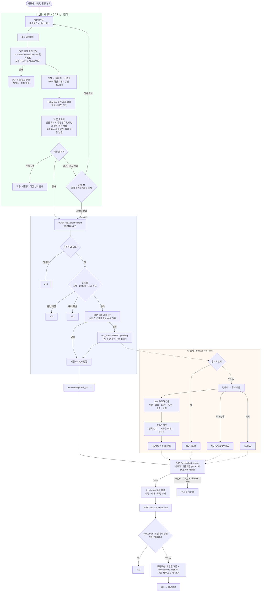

# OCR 처방전 인식 전체 흐름

> 기준: v2.0 재배포 S2(2026-10-20) — **처방전 사진은 기기를 떠나지 않는다.** 브라우저가 기기 안에서
> 글자를 읽고, 약 정보가 적힌 줄만 골라 서버로 보낸다.
>
> 이전 판(서버 OCR · Redis 임시 저장 시절, 2026-05 팀 프로젝트): git 이력에 그대로 있다 —
> [`docs/OCR_FLOW.md` @ `a2faf24`](https://github.com/kimyeongbin-dev/Doseph/blob/a2faf2406ee3debd1971010cd0fcfdfa8881aeb7/docs/OCR_FLOW.md)
>
> 이 문서가 다루지 않는 것: 약 이름 매칭의 세부 규칙(코드 `ai_worker/domains/ocr/medicine_matcher.py`) ·
> 서버 쪽 2차 개인정보 거르기(아직 없음, 다음 단계) · 직접 추가 화면의 입력 규칙.

## 한눈에

| 어디서 | 무엇을 | 무엇이 나가나 |
|---|---|---|
| 브라우저 (`/ocr`) | 사진 → 글자 → 약 줄 고르기 → 재촬영 판정 | **약 줄 글자만** (`{"text"}`) |
| API (`POST /ocr/extract`) | 형식·값 검증 → 중복 확인 → 작업 등록 | 작업 큐에 글자, DB 에 **글자 해시만** |
| AI 워커 | 정규화 → 후보 → LLM 구조화 → 약 DB 대조 | `ocr_drafts.medicines` |
| 브라우저 (`/ocr/loading` → `/ocr/result`) | SSE 로 결과 대기 → 사용자 검수 → 확정 | 검수된 약 목록 |

## 플로우차트

## 단계별 요약

| 단계 | 페이지/엔드포인트 | 역할 |
|------|-----------------|------|
| 기기 안 OCR | `/ocr` (`lib/ocr/browserOcr.js` · `ocrLines.js` · `retake.js`) | 사진 → 글자 → 약 줄 고르기 → 재촬영 판정 |
| 접수 | `POST /ocr/extract` | 형식(415)·문법(400)·값(422) 검증 → 글자 해시 중복 확인 → draft 생성·작업 등록 |
| 처리 | AI 워커 `process_ocr_task(text, draft_id)` | 정규화 → LLM 구조화 → 약 DB 대조 → `ocr_drafts` 갱신 |
| 대기 | `GET /ocr/draft/{id}/stream` (SSE) | 상태 변화만 push. 단발 조회는 `GET /ocr/draft/{id}` |
| 확정 | `POST /ocr/confirm` | 원자적 소비 → 처방전 그룹 + 약 저장 → 회수 약 확인 |
| 폐기 | `DELETE /ocr/draft/{id}` | 검수 화면의 «다시 촬영» — 활성 목록·중복 확인에서 뺀다 |
| 이어보기 | `GET /ocr/drafts/active` | 메인 카드 — 24시간 안 · 미확정 draft |

## 핵심 설계 포인트

- **사진은 기기 밖으로 나가지 않는다**: 업로드 API 가 이미지를 받지 않는다(415). 브라우저 저장소에도 넣지 않는다 —
  미리보기는 blob URL 이고, 진행 화면에는 `draft_id` 만 넘긴다.
- **틀려도 덜 보내는 쪽으로**: 약 줄 고르기는 «버리는 검사» 를 먼저 한다. 약 이름과 주민번호가 한 줄에 붙어 읽혀도
  그 줄은 나가지 않는다. 빠진 약은 사용자가 검수 화면에서 직접 더한다.
- **낮은 신뢰도는 권하고, 빈 결과는 막는다**: 평균 신뢰도가 기준(`RETAKE_CONFIDENCE`) 아래면 재촬영을 권하되
  진행할 수 있다. 진행해도 약 줄 고르기는 그대로 적용된다. 보낼 약 줄이 0개면 보내지 않는다.
- **서버는 글자 원문을 저장하지 않는다**: DB 에는 SHA-256 해시(중복 확인 키)만 남고, 원문은 작업 큐 payload 로만
  건너간다. 워커 로그에도 글자·약 이름 대신 길이·건수만 남긴다.
- **엔진 파일은 같은 출처로, 고정된 판으로**: 모델은 빌드 때 고정 리비전에서 받아 SHA-256 으로 대조한다.
  런타임에 제3자 호스트로 요청이 나가지 않는다. CSP 는 `'wasm-unsafe-eval'` 만 더했다(JS `eval` 은 계속 막힌다).
- **결과는 DB 에, 상태는 SSE 로**: 결과는 `ocr_drafts` 에 24시간 보관되어 페이지를 닫아도 메인 카드에서 이어볼 수 있다.
  실패 상태(no_text · no_candidates · failed)는 워커가 그 자리에서 소비 처리해 활성 목록에 쌓이지 않는다.
- **확정은 한 번만**: `consumed_at` 을 조건부 UPDATE 로 설정해 중복 확정을 409 로 막는다.
